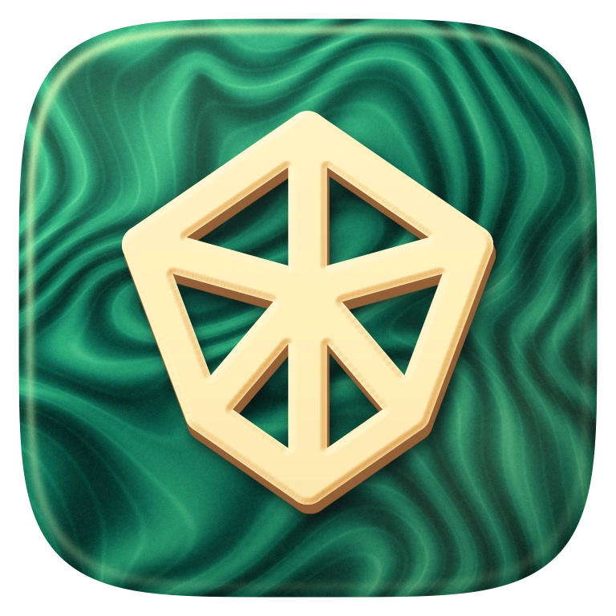
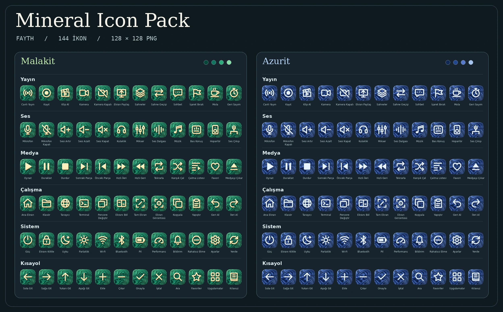

<div align="center">
  
  <h1>Mineral Icon Pack</h1>
  <p><strong>Polished Malachite with Gold Embossing &amp; Deep Azurite with Silver Embossing — 144 Retina 128×128 PNG Icons for evoX Deck &amp; Stream Deck.</strong></p>

  <p>
    <a href="dist/mineral-icon-pack-1.0.0.evoxpack">
      
    </a>
    <a href="dist/mineral-onizleme.webp">
      
    </a>
    <a href="#installation">
      
    </a>
    <a href="README.tr.md">
      
    </a>
  </p>

  <p>
    
    
    
    
    
    
  </p>
</div>

---

## Visual Showcase

<p align="center">
  
</p>

<details>
  <summary>View 768×768 Market Cover Artwork</summary>
  <p align="center">
    
  </p>
</details>

---

## Mineral Themes

Crafted by **Fayth** for **evoX Deck** and **Stream Deck**, the pack renders **72 original vector control glyphs** at 3× supersampling (`384×384` downsampled to crisp `128×128` transparent PNGs) across two natural stone finishes:

| Theme | Stone Surface | Embossed Metal | Filename Prefix | Icons |
| :--- | :--- | :--- | :--- | ---: |
| **Malachite** | Banded polished emerald-malachite | Warm brushed gold relief | `malakit-` | 72 |
| **Azurite** | Deep sapphire-azurite mineral | Cool polished silver relief | `azurit-` | 72 |

---

## Icon Categories

| Category | Included Controls | Per Theme | Total |
| :--- | :--- | ---: | ---: |
| **Streaming** | Go live, record, camera, screen share, scene transition, overlays | 12 | 24 |
| **Audio** | Microphone, mute, headphones, mixer, audio output, volume | 12 | 24 |
| **Media** | Play, pause, next track, repeat, shuffle, playback controls | 12 | 24 |
| **Workflow** | Folder, browser, terminal, screenshot, copy, productivity actions | 12 | 24 |
| **System** | Power, lock screen, Wi-Fi, brightness, do not disturb, settings | 12 | 24 |
| **Shortcuts** | Directional arrows, confirm, cancel, search, app launcher | 12 | 24 |
| **Total** | **72 unique glyphs across 2 gemstone finishes** | **72** | **144** |

---

## Installation

### Method 1: evoX Deck (`.evoxpack` — Recommended)

1. Download [`mineral-icon-pack-1.0.0.evoxpack`](dist/mineral-icon-pack-1.0.0.evoxpack).
2. Open the **evoX** desktop app and navigate to **Market → Import** to load the pack in one click.
3. Select any deck key and pick an icon from your library — filenames start with `malakit-` or `azurit-` for instant theme filtering.

### Method 2: Manual PNG Import (evoX Deck / Elgato Stream Deck)

1. Extract the PNGs from `assets/icons/` inside `mineral-icon-pack-1.0.0.evoxpack` (standard ZIP archive).
2. In **evoX Deck**, go to **Icons → Add** and select the extracted PNGs; or in **Elgato Stream Deck**, choose **Set from File** on any key.

> [!TIP]
> Official evoX documentation: [Installing a Downloaded Pack](https://docs.evox.wraithesports.app/application/market-plugins#webden-indirilen-paketi-kurma) · [Icon Library](https://docs.evox.wraithesports.app/application/icons-sounds) · [Publishing Guide](https://docs.evox.wraithesports.app/application/publish-your-pack)

---

## evoX Market Metadata

<details>
  <summary>Show package submission fields for evoX Web Market</summary>

| Field | Value |
| :--- | :--- |
| **Pack Name** | Mineral Icon Pack |
| **Publisher** | Fayth |
| **Version** | `1.0.0` |
| **Description** | Polished malachite and azurite tiles with embossed metallic glyphs. 72 original icons for streaming, audio, media, workflow, system, and shortcuts — 144 icons across two themes. |
| **Package** | [`dist/mineral-icon-pack-1.0.0.evoxpack`](dist/mineral-icon-pack-1.0.0.evoxpack) |
| **Cover** | [`dist/mineral-kapak.webp`](dist/mineral-kapak.webp) (`768 × 768 px`) |

</details>

---

## Rebuilding From Source

Every icon, stone texture, metallic bevel, cover, and catalog preview is generated procedurally from Python.

**Requirements:** Python 3.11+, Cairo, and DejaVu Sans/Serif fonts (set `MINERAL_FONT_DIR` if your fonts live outside `/usr/share/fonts/truetype/dejavu`).

```bash
python -m pip install -r requirements.txt
python build.py
python validate.py
```

```text
mineral-icon-pack/
├── glyphs.py          # 72 SVG vector glyph definitions grouped by category
├── materials.py       # Procedural malachite & azurite stone shaders + metallic relief
├── build.py           # 3× supersampled renderer, .evoxpack packager & preview generator
├── validate.py        # Archive integrity, manifest paths, 144 PNGs & cover validator
├── requirements.txt   # Python dependencies
└── dist/
    ├── mineral-icon-pack-1.0.0.evoxpack
    ├── mineral-kapak.webp
    └── mineral-onizleme.webp
```

## License

Project-owned code and original material in this revision are licensed under [GNU GPL v3.0](LICENSE) (GPL-3.0-only). Third-party code, fonts, imagery, data, and brand assets retain their own terms and attributions.
