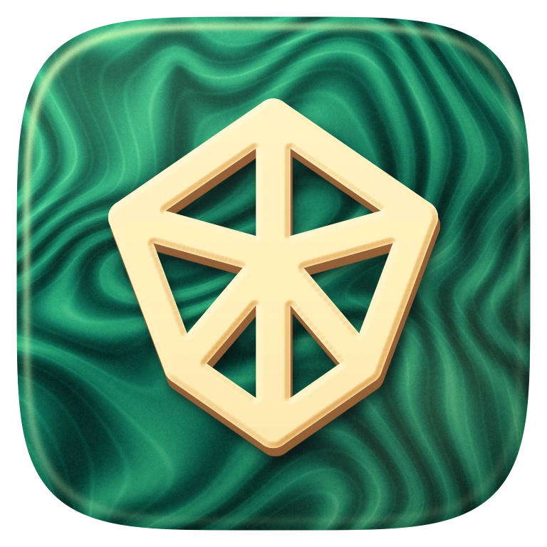
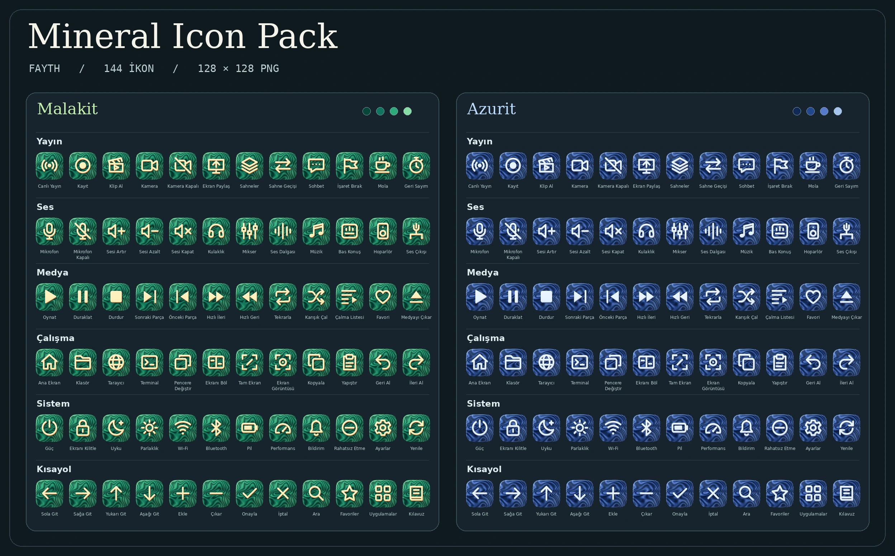

<div align="center">
  
  <h1>Mineral Icon Pack</h1>
  <p><strong>Cilalı malakit üzerinde altın ve derin azurit üzerinde gümüş kabartma — evoX Deck ve Stream Deck için 144 adet 128×128 şeffaf PNG ikon.</strong></p>

  <p>
    <a href="dist/mineral-icon-pack-1.0.0.evoxpack">
      
    </a>
    <a href="dist/mineral-onizleme.webp">
      
    </a>
    <a href="#evox-decke-ekleme">
      
    </a>
    <a href="README.md">
      
    </a>
  </p>

  <p>
    
    
    
    
    
    
  </p>
</div>

---

## Görsel Katalog

<p align="center">
  
</p>

<details>
  <summary>768×768 Market Kapağını Görüntüle</summary>
  <p align="center">
    
  </p>
</details>

---

## Mineral Temaları

**Fayth** tarafından **evoX Deck** ve **Stream Deck** için hazırlanan set, **72 özgün kontrol simgesini** 3× süper örnekleme (`384×384` → keskin `128×128` şeffaf PNG) ile iki doğal taş yüzeyinde sunar:

| Tema | Taş Dokusu | Kabartma Metal | Dosya Öneki | İkon |
| :--- | :--- | :--- | :--- | ---: |
| **Malakit** | Damarlı cilalı zümrüt malakit | Sıcak fırçalanmış altın kabartma | `malakit-` | 72 |
| **Azurit** | Derin safir azurit taşı | Soğuk cilalı gümüş kabartma | `azurit-` | 72 |

---

## İkon Grupları

| Grup | Örnekler | Her Temada | Toplam |
| :--- | :--- | ---: | ---: |
| **Yayın** | Canlı yayın, kayıt, kamera, ekran paylaşımı, sahne geçişi | 12 | 24 |
| **Ses** | Mikrofon, sessize alma, kulaklık, mikser, ses çıkışı | 12 | 24 |
| **Medya** | Oynat, duraklat, sonraki parça, tekrar, karışık çal | 12 | 24 |
| **Çalışma** | Klasör, tarayıcı, terminal, ekran görüntüsü, kopyala | 12 | 24 |
| **Sistem** | Güç, ekran kilidi, Wi-Fi, parlaklık, rahatsız etme | 12 | 24 |
| **Kısayol** | Yönler, onayla, iptal, ara, uygulamalar | 12 | 24 |
| **Toplam** | **2 mineral temasında 72 özgün kontrol simgesi** | **72** | **144** |

---

## evoX Deck'e Ekleme

### Yöntem 1: `.evoxpack` ile Tek Tıkla (Önerilen)

1. [`mineral-icon-pack-1.0.0.evoxpack`](dist/mineral-icon-pack-1.0.0.evoxpack) dosyasını indir.
2. evoX masaüstü uygulamasında **Market → İçe aktar** üzerinden paketi seç.
3. Bir tuş seçip ikon kütüphanesinden istediğin simgeyi ata. Dosya adları `malakit-` ve `azurit-` önekleriyle temayı gösterir.

### Yöntem 2: Tekil PNG / Elgato Stream Deck

1. `mineral-icon-pack-1.0.0.evoxpack` arşivi içindeki `assets/icons/` klasöründen istediğin PNG'leri çıkar.
2. **evoX Deck**'te **İkonlar → Ekle** üzerinden seç; **Elgato Stream Deck**'te herhangi bir tuşta **Dosyadan Ayarla** seçeneğini kullan.

> [!TIP]
> Resmi evoX belgeleri: [Paket İçe Aktarma](https://docs.evox.wraithesports.app/application/market-plugins#webden-indirilen-paketi-kurma) · [İkon Kütüphanesi](https://docs.evox.wraithesports.app/application/icons-sounds) · [Yayınlama Kılavuzu](https://docs.evox.wraithesports.app/application/publish-your-pack)

---

## evoX Market Gönderimi

<details>
  <summary>evoX Web Market gönderim alanlarını göster</summary>

| Alan | İçerik |
| :--- | :--- |
| **Paket adı** | Mineral Icon Pack |
| **Yayıncı adı** | Fayth |
| **Sürüm** | `1.0.0` |
| **Açıklama** | Cilalı malakit ve azurit üzerinde kabartma metal simgeler. Yayın, ses, medya, çalışma, sistem ve kısayollar için 72 özgün simge, iki temada 144 ikon. |
| **Paket** | [`dist/mineral-icon-pack-1.0.0.evoxpack`](dist/mineral-icon-pack-1.0.0.evoxpack) |
| **Kapak** | [`dist/mineral-kapak.webp`](dist/mineral-kapak.webp) (`768 × 768 piksel`) |

Web Market'te **Yayınla** sayfasından `.evoxpack` dosyasını ve kapağı seç. Önce **Yükle ve tara**, ardından taslak hazır olduğunda **Moderasyona gönder** adımını kullan.

</details>

---

## Paketi Yeniden Üretme

Python 3.11+, Cairo ve DejaVu Sans/Serif yazı tipleri gerekir. Yazı tipleri farklı bir klasördeyse `MINERAL_FONT_DIR` ile belirt.

```sh
python -m pip install -r requirements.txt
python build.py
python validate.py
```

`glyphs.py` simgeleri, `materials.py` taş dokularını ve kabartmayı tanımlar. `build.py` paketi, kapağı ve kataloğu `dist/` altında üretir. `validate.py` arşiv bütünlüğünü, manifestteki dosya yollarını, 144 PNG'yi ve kapağı kontrol eder.
